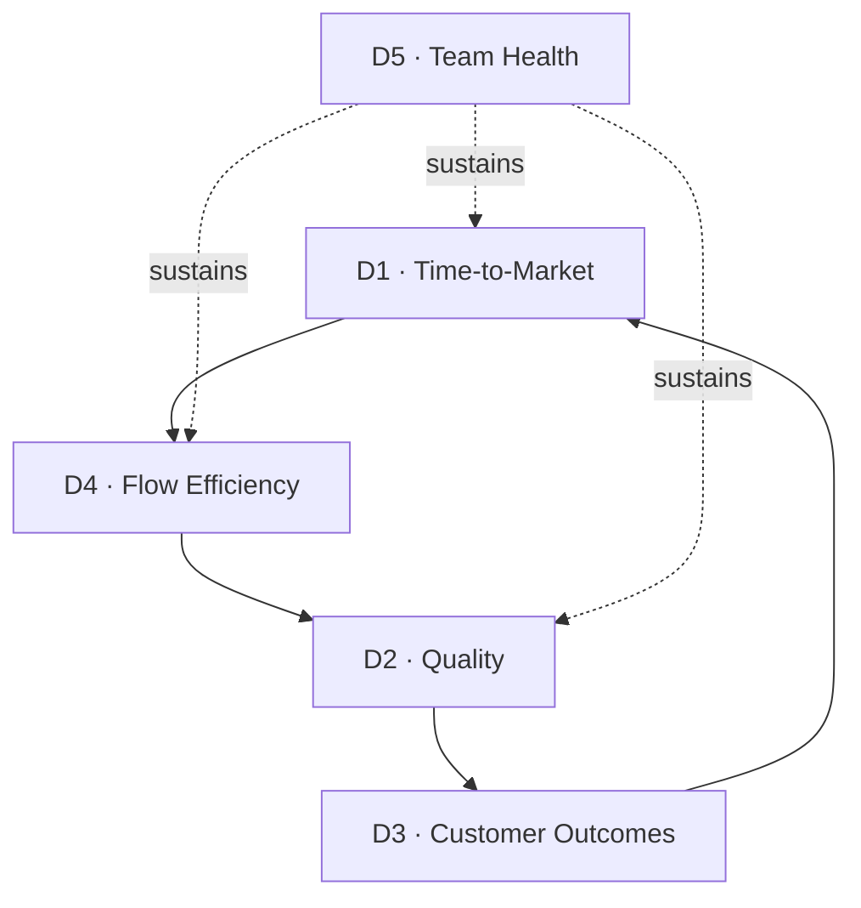

# Services Delivery Maturity Model

**Assessing how effectively an organization turns ideas and commitments into reliable services, quality outcomes and customer value.**

The Services Delivery Maturity Model focuses on the organization's ability to deliver services and products predictably, efficiently and with measurable outcomes for customers. It considers the flow from idea to production, the quality built into delivery, the outcomes experienced by customers, the efficiency of delivery flow and the health and sustainability of the teams doing the work.

The repository currently provides a stable five-level maturity scale and an initial **draft** criteria register. The register establishes the assessment's initial coverage, but it is not yet a complete, calibrated assessment instrument.

---

## Find your starting point

| If you are a... | Start with |
|---|---|
| Executive, product or delivery sponsor | [What the model assesses](#what-the-model-assesses) and [Maturity progression](#maturity-progression) |
| Head of delivery or engineering leader | [The five assessment dimensions](#the-five-assessment-dimensions) |
| Product or service owner | [Customer outcomes](#the-five-assessment-dimensions) and [Assessment boundaries](#relationship-to-operations-and-other-models) |
| Quality, reliability or DevOps leader | [Quality and flow efficiency](#the-five-assessment-dimensions) |
| Team or people leader | [Team health](#the-five-assessment-dimensions) |
| Assessor or model contributor | [Current assessment assets](#current-assessment-assets) and [Governance](#governance-and-contribution) |

## What the model assesses

Services delivery is the organizational capability to convert demand and ideas into production services and products that meet quality expectations and achieve intended customer outcomes.

The model addresses five connected questions:

- **Time-to-market:** How quickly and predictably can the organization move work from idea to production?
- **Quality:** How effectively is quality built into delivery, verified before release and improved through feedback?
- **Customer outcomes:** Are intended customer outcomes defined, measured and used to guide delivery?
- **Flow efficiency:** Is the movement of work through the delivery system visible, balanced and predictable?
- **Team health:** Can teams sustain a healthy pace, remain engaged and maintain the capability to deliver over time?

The model is concerned with delivery effectiveness and outcomes, not simply project completion, release frequency or engineering activity. A mature delivery capability connects flow and execution measures to product/service quality and customer value.

## The five assessment dimensions

The current seed criteria register organizes the model into five dimensions and ten subdimensions. It currently contains 14 criterion statements.

| ID | Dimension | Assessment focus |
|---|---|---|
| **D1** | Time-to-Market | Lead time from idea to production, batch size and release cadence |
| **D2** | Quality | Automated verification, change failure and escaped-defect prevention |
| **D3** | Customer Outcomes | Definition of measurable customer outcomes and evidence of adoption, satisfaction and outcome attainment |
| **D4** | Flow Efficiency | Flow efficiency, flow-state visibility, delivery forecasting and commitment reliability |
| **D5** | Team Health | Team sustainability, engagement and sustainable pace |

These dimensions provide the initial coverage structure. The current register is deliberately marked draft: its criterion statements and evidence prompts are seeds, not yet a complete set of approved assessment propositions with full definitions, assessment questions, applicability rules, level anchors and scoring weights.

## How the dimensions work together

The five dimensions form a connected delivery system. Flow and predictability affect time-to-market; built-in quality protects the service and customer experience; customer outcomes provide the measure of delivered value; and team health sustains delivery capability over time.

A strong result in one dimension does not compensate automatically for a weakness in another. For example, faster releases do not demonstrate effective delivery if quality deteriorates or customer outcomes are not achieved.

## Maturity progression

The model uses five capability levels and a separate L-0 Not Assessed state. L-0 indicates that a criterion has not been assessed; it is not a capability maturity level and must not be interpreted as evidence that the capability is absent.

| Level | Name | Canonical score range | Delivery interpretation |
|---|---|---:|---|
| L-0 | Not Assessed | Not a maturity band | No criterion evidence has been assessed |
| L-1 | Emergent | 0–20 | Delivery is unpredictable and relies on individual effort |
| L-2 | Structured | 21–45 | Core delivery practices are documented and increasingly consistent |
| L-3 | Systematic | 46–70 | Delivery is managed through flow, quality and outcome measures |
| L-4 | Adaptive | 71–88 | Delivery adapts using predictive insight, experimentation and measured value |
| L-5 | Self-Optimising | 89–100 | Continuous delivery improvement is embedded and increasingly autonomous |

The model's maturity definitions, characteristics and evidence expectations are maintained in [maturity/scale.yaml](maturity/scale.yaml). The canonical score bands are:

| Band | Score range | Effort multiplier |
|---|---:|---:|
| Emergent | 0–20 | 1.0× |
| Structured | 21–45 | 1.5× |
| Systematic | 46–70 | 2.5× |
| Adaptive | 71–88 | 4.0× |
| Self-Optimising | 89–100 | 6.0× |

The current seed criteria register does not yet define a complete criterion-level scoring and aggregation method. The existence of canonical maturity bands does not, by itself, constitute a fully specified evaluation procedure.

## Current assessment assets

The repository's assessment assets have different levels of completion:

| Asset | Current state | Use |
|---|---|---|
| [Maturity scale](maturity/scale.yaml) | Stable | Defines L-0 Not Assessed and the five capability levels |
| [Services Delivery model register](maturity/model/services-delivery.yaml) | Stable | Defines model identity and scale relationship |
| [Seed criteria register](maturity/model/services-delivery-register-draft.yaml) | Draft | Provides initial five-dimension, ten-subdimension criterion coverage |
| [Worked example](examples/services-delivery-2026.yaml) | Illustrative | Demonstrates sample canonical band resolution and effort-adjusted value; it is not a criterion-level assessment |
| [Model manifest](model.yaml) | Current repository identity | Declares model identity, version, dependencies and contract relationship |

A complete questionnaire, criterion-level evidence schema and normative evaluation profile are not yet published. The next substantive model-development work is to refine the criteria, define assessment questions and evidence expectations, establish scoring and aggregation rules, and produce worked assessment records that exercise the completed method.

## Relationship to Operations and other models

Services Delivery and Operations are closely related, but they assess different concerns.

- **Operations** assesses the enterprise's internal operating system: value-stream visibility, work-in-progress, daily commitments, capability orchestration and the operating practices that enable work to flow.
- **Services Delivery** assesses the effectiveness of converting demand into delivered services and products, including time-to-market, built-in quality, customer outcomes, delivery flow efficiency and team sustainability.

The boundary is not that one model owns all flow and the other owns all delivery. The Operations model provides evidence about upstream operational flow-state; Services Delivery consumes relevant evidence and focuses on delivery-system performance and customer-facing outcomes.

| Assessment concern | Relevant model | Boundary |
|---|---|---|
| Enterprise value-stream operations and internal flow-state | [Operations Maturity Model](https://github.com/Assessment-Models/maturity-model-operations) | Owns value-stream visibility, WIP and daily operating commitments; Services Delivery consumes relevant upstream evidence |
| Closed-loop, intent-driven autonomous execution | [Autonomous Operations Maturity Model](https://github.com/Assessment-Models/maturity-model-autonomous-operations) | Assesses operational autonomy, OODA ownership and agent governance |
| Technology estate fitness and platform capability | [Technology Maturity Model](https://github.com/Assessment-Models/maturity-model-technology) | Assesses technology capabilities that enable delivery; Services Delivery assesses delivery effectiveness |
| Enterprise-wide digital transformation | [Digital Transformation Maturity Model](https://github.com/Assessment-Models/maturity-model-digital-transformation) | Assesses the broader business and operating-model transformation |
| Architecture modernization | [Architecture Modernization Assessment](https://github.com/Assessment-Models/maturity-model-modernization) | Assesses architecture modernization need and modernization-practice maturity |

The intended principle is **one criterion, one owning model**. Evidence may be reused through declared touchpoints, but model criteria, scoring and maturity results are not interchangeable. See [touchpoints.yaml](touchpoints.yaml) for the declared Operations relationship.

## Worked example

The [services-delivery-2026 example](examples/services-delivery-2026.yaml) is illustrative. It demonstrates sample 0–100 aggregation, canonical band resolution and effort-adjusted value. Its criterion identifiers are placeholders, and its weights are omitted; it must not be interpreted as a complete or calibrated organization assessment.

## How to use the model today

For exploratory use:

1. Review the [maturity scale](maturity/scale.yaml) to understand the progression from Emergent to Self-Optimising.
2. Use the five dimensions as a discovery structure for delivery-system discussions.
3. Review the [seed criteria register](maturity/model/services-delivery-register-draft.yaml) as an initial set of propositions and evidence prompts.
4. Examine delivery records, quality measures, customer outcome data, flow metrics and team-health evidence.
5. Treat any aggregate score derived from the illustrative example as a demonstration of band arithmetic only, not as an organizational maturity result.

Do not use the seed register as a formally calibrated benchmark or compare results across organizations until the questionnaire, evidence requirements and evaluation rules have been completed and governed.

## Repository contents

| Resource | Purpose |
|---|---|
| [model.yaml](model.yaml) | Model identity, dependencies and contract declaration |
| [maturity/scale.yaml](maturity/scale.yaml) | Stable maturity scale and capability-level definitions |
| [maturity/model/services-delivery.yaml](maturity/model/services-delivery.yaml) | Stable model register |
| [maturity/model/services-delivery-register-draft.yaml](maturity/model/services-delivery-register-draft.yaml) | Draft criterion register |
| [examples/services-delivery-2026.yaml](examples/services-delivery-2026.yaml) | Illustrative scoring example |
| [touchpoints.yaml](touchpoints.yaml) | Declared relationship with Operations |
| [CHANGELOG.md](CHANGELOG.md) | Versioned model changes |
| [CONTRIBUTING.md](CONTRIBUTING.md) | Change-control and contribution rules |

## Governance and contribution

The Services Delivery Maturity Model is maintained by the [Assessment-Models organisation](https://github.com/Assessment-Models). Changes to model identity, maturity definitions, dimensions, criteria, scoring or evidence semantics must follow the repository's change-control process.

Contributors should preserve the distinction between the stable maturity scale and the draft criteria register. Criterion refinements should be accompanied by complete definitions, assessment questions, applicability rules, evidence expectations and observable level anchors. Scoring, aggregation and weighting should be specified and validated before the register is promoted to a stable assessment instrument.

See [CONTRIBUTING.md](CONTRIBUTING.md) and [CHANGELOG.md](CHANGELOG.md).

## Status

**Repository maturity-model release: 2.0.0** · **Criteria register:** draft · **Maturity scale:** stable

The repository has adopted the L-0 Not Assessed plus L-1…L-5 numbering convention. The seed criteria register remains a draft model extension and is not yet a complete assessment instrument.

## Licence

MIT. See [LICENSE](LICENSE).
